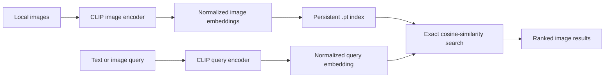

# Visual Search Engine

A multimodal image-retrieval prototype that searches a local image collection
using natural-language descriptions or another image.

The project uses CLIP to place text and images in the same embedding space,
then ranks stored image embeddings with normalized cosine similarity.

> **Status:** Complete learning prototype. The project implements the core
> multimodal retrieval pipeline as a tested command-line application.

## Features

- Natural-language to image search
- Reverse image-to-image search
- OpenAI-pretrained CLIP `ViT-B-32-quickgelu` through OpenCLIP
- Normalized 512-dimensional text and image embeddings
- Persistent local image index, so dataset images are encoded only once
- Exact top-k cosine-similarity ranking
- Reusable embedding and search components
- Automated tests for loading, ranking, result limits, and invalid inputs
- Manage and publish a software project using Git and GitHub

## How It Works



### Indexing

1. Images are loaded and preprocessed for CLIP.
2. CLIP converts each image into a normalized embedding.
3. Embeddings, relative image paths, and model information are saved to
   `data/index/image_index.pt`.

### Searching

1. The saved image index is loaded without reopening or re-encoding the dataset.
2. Only the new text or image query is encoded.
3. The query embedding is compared with every stored image embedding.
4. The highest-scoring images are returned in ranked order.

## Technology Stack

- Python 3.12
- NumPy
- PyTorch and TorchVision
- OpenCLIP
- Pillow
- pytest
- Git and GitHub

## Project Structure

```text
visual-search-engine/
├── experiments/                 # Step-by-step learning experiments
├── scripts/
│   ├── build_index.py           # Build the persistent image index
│   ├── search_image.py          # Search using an image query
│   └── search_text.py           # Search using natural language
├── src/visual_search/
│   ├── __init__.py
│   ├── embedder.py              # Reusable CLIP embedding component
│   └── exact_index.py           # Persistent exact-search component
├── tests/
│   └── test_exact_index.py
├── pyproject.toml
└── README.md
```

The local `data/` directory is intentionally ignored by Git because image
datasets and generated indexes can be large.

## Installation

Clone the repository and enter it:

```powershell
git clone https://github.com/ermatio/visual-search-engine.git
cd visual-search-engine
```

Create and activate a virtual environment:

```powershell
py -3.12 -m venv .venv
.\.venv\Scripts\Activate.ps1
```

Install the CPU version of PyTorch, followed by the project and development
dependencies:

```powershell
python -m pip install --upgrade pip
python -m pip install torch torchvision --index-url https://download.pytorch.org/whl/cpu --timeout 120
python -m pip install -e ".[dev]"
```

The pretrained CLIP weights are downloaded automatically the first time the
model is loaded.

## Prepare a Local Dataset

Create these directories:

```powershell
New-Item -ItemType Directory -Path data\images -Force
New-Item -ItemType Directory -Path data\query -Force
```

Place the searchable `.jpg`, `.jpeg`, or `.png` files in `data/images/`. Place
an external image used for reverse-image search in `data/query/`.

## Build the Image Index

Run this command whenever images are added, removed, or replaced:

```powershell
python scripts\build_index.py
```

The generated index is stored at `data/index/image_index.pt`.

## Search With Natural Language

```powershell
python scripts\search_text.py
```

Example:

```text
Describe the image you want: a car on a highway

Results for: a car on a highway

car.jpg: 0.200
cat.jpg: 0.173
forest.jpg: 0.154
dog.jpg: 0.151
```

Similarity scores are ranking values, not confidence percentages.

## Search With Another Image

```powershell
python scripts\search_image.py
```

When prompted, enter a relative path such as:

```text
data/query/query.jpg
```

## Run the Tests

```powershell
python -m pytest
```

The tests use small synthetic embeddings and do not load CLIP or require the
real image dataset.

## Current Limitations

- Search currently uses a small local dataset.
- Inference runs on the CPU by default.
- Exact search compares the query with every stored image, so search time grows
  linearly with the collection size.
- The current interface is command-line based.
- The index must be rebuilt after the dataset changes.

## Project Scope

The project intentionally focuses on the core image-retrieval pipeline:
embedding generation, persistent indexing, similarity search, ranking, and
testing.

## Optional Future Improvements

- [ ] Add FAISS and benchmark it against exact search
- [ ] Store image metadata with SQLite
- [ ] Expose search through FastAPI
- [ ] Build a web interface
- [ ] Package the application with Docker
- [ ] Evaluate Recall@K and search latency on a larger dataset

## What I Learned

Through this project, I learned how to:

- Represent images and text using normalized CLIP embeddings
- Use cosine similarity to compare embeddings
- Implement text-to-image and image-to-image retrieval
- Perform vectorized ranking with PyTorch
- Persist image embeddings and reuse them across searches
- Structure reusable Python components
- Write automated tests with pytest

